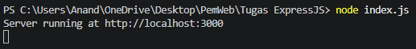
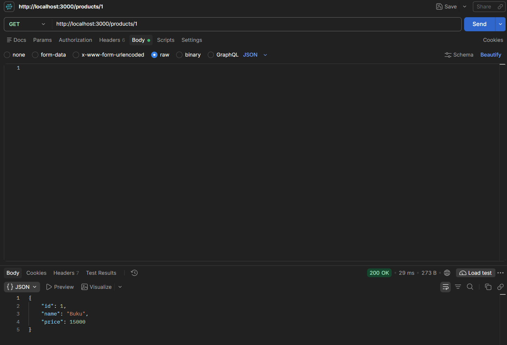
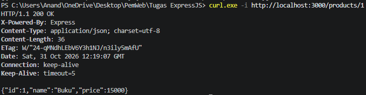
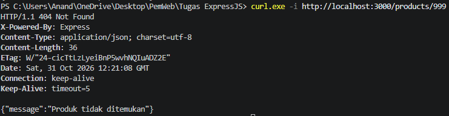
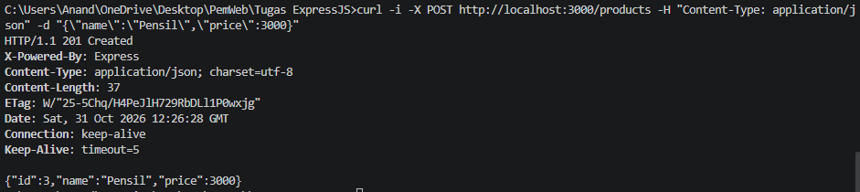
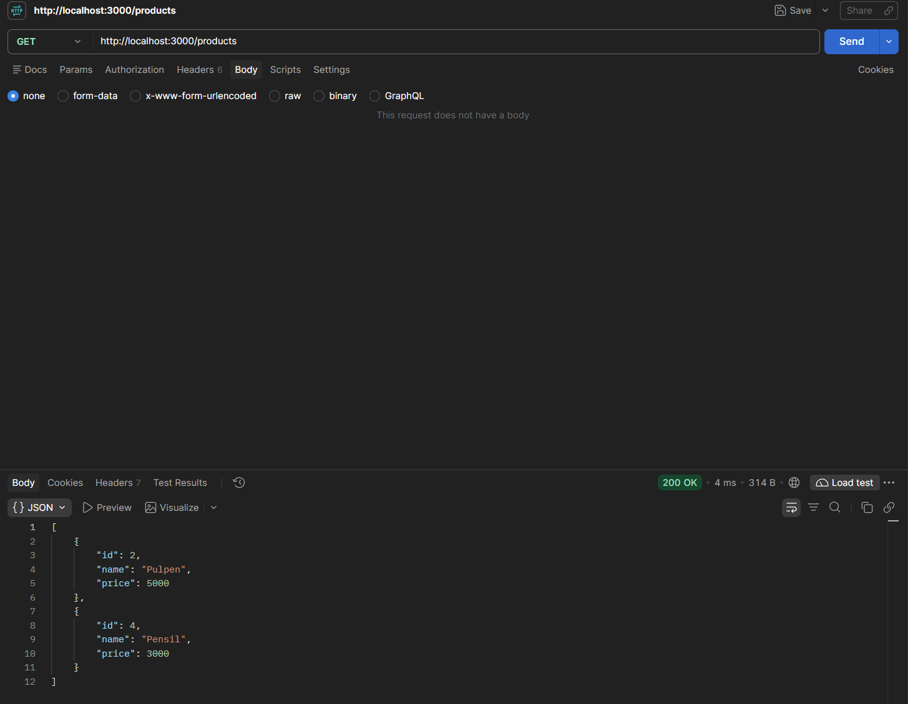

# Express dan Prisma CRUD

API produk menggunakan Express, SQLite, dan Prisma.

## Menjalankan project

```powershell
npm install
npm run prisma:generate
npx prisma db push
npm run prisma:seed
npm start
```

Server berjalan di `http://localhost:3000`.

## Endpoint produk

| Method | Endpoint | Keterangan |
|---|---|---|
| GET | `/products` | Menampilkan semua produk |
| GET | `/products/:id` | Menampilkan produk berdasarkan ID |
| POST | `/products` | Membuat produk baru |
| PUT | `/products/:id` | Mengubah produk |
| DELETE | `/products/:id` | Menghapus produk |

Contoh body JSON untuk POST dan PUT:

```json
{
  "name": "Pensil",
  "price": 3000
}
```

Screenshot Pembuktian Menggunakan Postman





