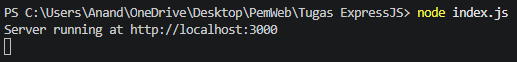
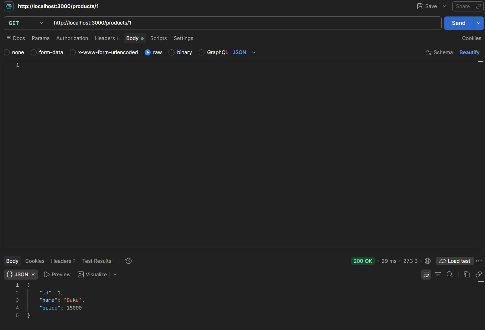
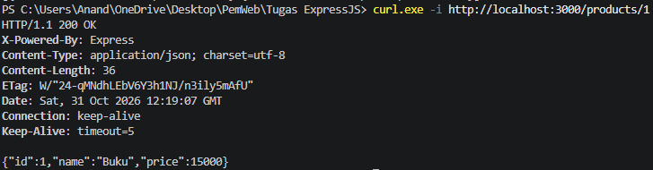
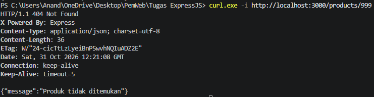
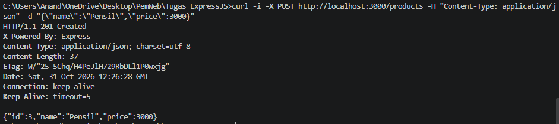
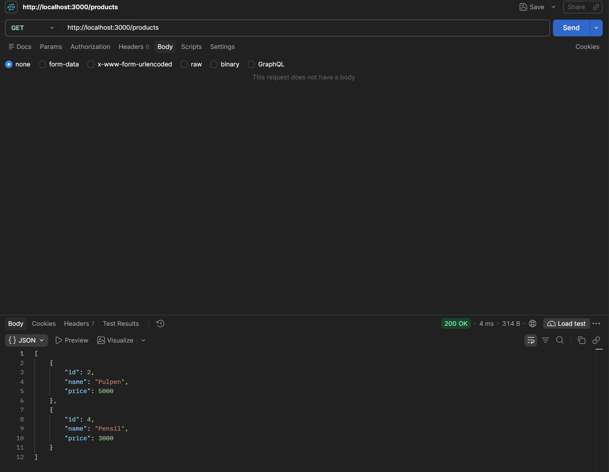

# Manajemen Produk

Manajemen produk dengan React, React Router, Tailwind CSS, Express, SQLite, dan Prisma.

## Persiapan database

```powershell
npm install
npm run prisma:generate
npx prisma db push
npm run prisma:seed
```

## Menjalankan aplikasi

Untuk memakai UI React saat development, jalankan server API dan Vite pada dua terminal:

```powershell
# Terminal 1
npm start

# Terminal 2
npm run dev
```

Buka URL Vite yang ditampilkan di terminal (biasanya `http://localhost:5173`). Server API berjalan di `http://localhost:3000`.

Untuk menjalankan UI melalui Express, build terlebih dahulu:

```powershell
npm run build
npm start
```

Kemudian buka `http://localhost:3000`. Express menyajikan aplikasi React dari folder `dist`.

## Fitur UI

- Daftar produk dengan pilihan tampilan grid atau list.
- Tambah, lihat detail, edit, dan hapus produk.
- Halaman detail menggunakan `/products/:id`; ID yang tidak ditemukan menampilkan pesan 404 dan tautan kembali.
- Pilihan grid/list pada Settings tersimpan di browser.

## Endpoint produk

| Method | Endpoint | Keterangan |
|---|---|---|
| GET | `/products` | Menampilkan semua produk |
| GET | `/products/:id` | Menampilkan produk berdasarkan ID untuk permintaan JSON |
| POST | `/products` | Membuat produk baru |
| PUT | `/products/:id` | Mengubah produk |
| DELETE | `/products/:id` | Menghapus produk |

Browser menggunakan URL detail yang sama (`/products/:id`) untuk menampilkan halaman React. Endpoint API tetap menghasilkan JSON untuk permintaan JSON.

Contoh body JSON untuk POST dan PUT:

```json
{
  "name": "Pensil",
  "price": 3000
}
```

Screenshot pengujian API menggunakan Postman:





