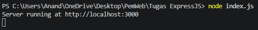
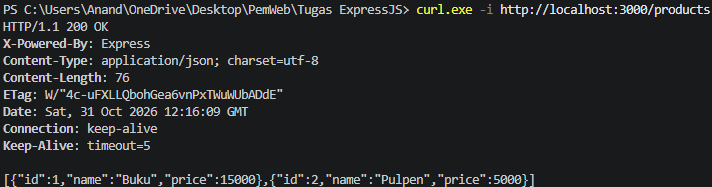
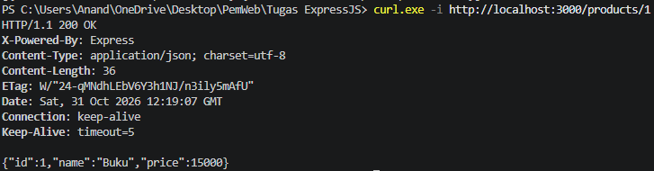
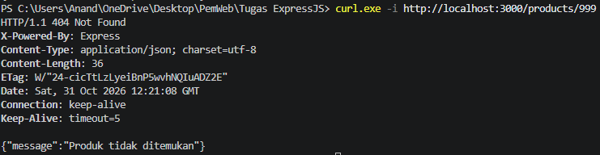
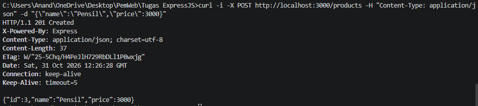

# I Made Gyanendra Anand Wisnawa / 5027251072
# Tugas ExpressJS

## Setup Awal untuk Testing
Untuk memulai tahap testing buka terminal dengan ctrl + ` dan jalankan inisialisasi proyek baru di terminalnya.
```
npm init -y
```

(Ini untuk menambahkan package.json)

Setelah itu, kita install dependensi express.
```
npm install express
```

Setelah terjalan, kita jalankan server di index.js dengan
```
node index.js
```

## Testing
Setelah `node index.js` terjalan akan terlihat seperti ini


Untuk saya, server berjalan di localhost:3000

Setelah server berjalan, kita sudah bisa melakukan request uji dari soalnya dimana pertama kita test GET /products.

Untuk melakukan testing ini, saya menggunakan fungsi curl.
```
curl.exe -i http://localhost:3000/products
```


Disini terlihat status 200 OK berserta dengan array seluruh produk yang sesuai dengan hasil yang diharapkan.

Berikut kita lakukan uji request GET /products/1 untuk menampilkan produk berdasarkan IDnya.
```
curl.exe -i http://localhost:3000/products/1
```


Setelah berjalan kita sekali lagi bisa melihat status 200 OK dan produk buku yang sesuai dengan hasil yang diharapkan.

Next kita uji request GET /products/999, saat ini dijalankan seharusnya kita mendapatkan message error dan text untuk error handlingnya.
```
curl.exe -i http://localhost:3000/products/999
```


Kita bisa lihat status error 404 Not Found dan pesan JSON produk tidak ditemukan yang sesuai dengan hasil yang diharapkan.

Terakhir untuk lanjutan tugas kita ditugaskan untuk menambahkan POST /products untuk menerima name dan price, membuat ID baru, lalu mengembalikan produk dengan status 201. Untuk ini, kita jalankan curl berikut dengan request POST.
```
curl -i -X POST http://localhost:3000/products -H "Content-Type: application/json" -d "{\"name\":\"Pensil\",\"price\":3000}"
```


Disini bisa dilihat status 201 Created dan juga menampilkan produk barunya yaitu pensil dengan ID 4.

Note: untuk post tersendiri saya perlu untuk masuk ke command prompt dengan mengetik `cmd` untuk menjalankan curl untuk post, sebelumnya testing menggunakan powershell makanya menggunakan curl.exe tetapi untuk command prompt tersendiri hanya perlu menggunakan curl.